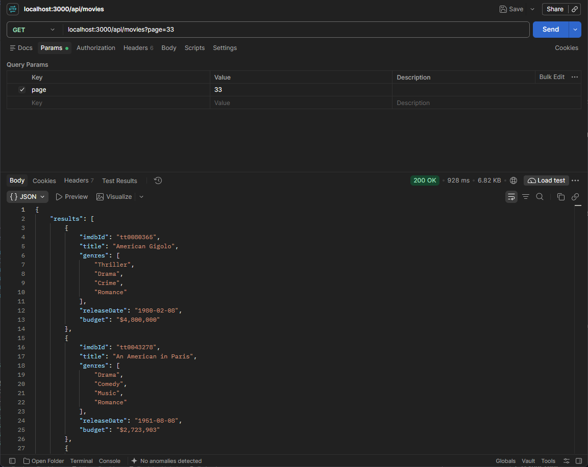
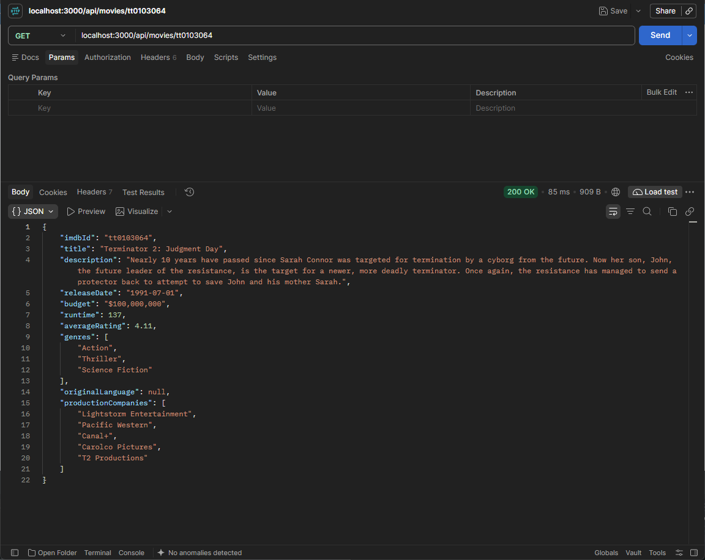
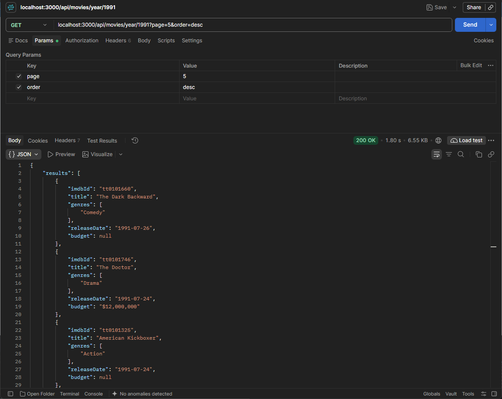
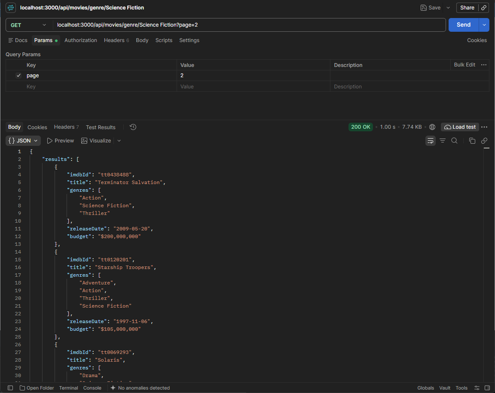

# Movies & Ratings API Challenge

A modular, highly scalable Node.js API built with **Express**, **TypeScript**, and **Drizzle ORM**, querying dual independent SQLite databases (`movies.db` and `ratings.db`).

## 🛠️ Architectural Highlights
- **Feature-Driven Structure:** Organizes codebase slices by domain context (`src/features/movies`) rather than splitting routers and schemas across distant global folders.
- **Decoupled ORM Design:** Minimizes memory consumption and eliminates binary engine overhead by leveraging Drizzle ORM to perform lightweight cross-database application-level stitching.
- **SQLite JSON Extension Integration:** Leverages native `json_each` scanning to map and query stringified database text arrays directly on the database engine.
- **Resilient Data Transformations:** Safely parses stringified JSON columns into flat arrays. 
  
  > 💡 **Data Integrity Note on Budgets:** If a movie's budget is recorded as `0`, the API intentionally transforms and handles this as `null` rather than formatting it as `"$0"`. In production movie datasets, a zero budget represents **missing or unrecorded data** rather than a movie that cost nothing to make. Returning `null` prevents skewed data metrics downstream and allows frontend clients to cleanly render an "Unknown" placeholder.

---

## 📂 Directory Structure

The project separates host-level storage binaries from application code using a modular, feature-focused (vertical-slice) folder hierarchy. Postman verification captures are captured and maintained inside the dedicated repository documentation folders:

```text
ratings-movies-api/
├── db/                       # Host binary database files (Ignored by Git)
│   ├── .gitkeep              # Keeps empty directory trackable on clone
│   ├── movies.db
│   └── ratings.db
├── doc/                      # Documentation assets
│   └── screenshots/          # 📸 Place your Postman verification images here
│       ├── 1-list-all-movies.png
│       ├── 2-movie-details.png
│       ├── 3-movies-by-year.png
│       └── 4-movies-by-genre.png
├── src/
│   ├── database/             # Core connection initialization & configuration
│   │   └── index.ts
│   ├── features/             # Self-contained domain layers
│   │   └── movies/
│   │       ├── movie.routes.ts
│   │       ├── movie.schema.ts
│   │       └── movie.test.ts
│   ├── middleware/           # Global API orchestration layers
│   │   └── errorHandler.ts   # Intercepts 404s and catastrophic failures
│   ├── app.ts                # Express application orchestration
│   └── server.ts             # Application network entry point
├── .dockerignore
├── .gitignore
├── docker-compose.yml
├── Dockerfile
├── jest.config.mts
├── package.json
├── tsconfig.build.json
└── tsconfig.json
```

---

## ⚡ Performance Optimization & Indexing

Because this architecture maintains separation between `movies.db` and `ratings.db`, standard SQL `JOIN` constraints across files are unavailable. Instead, records are queried sequentially and aggregated within the Node.js application layer. 

To ensure sub-millisecond data aggregation speeds as the datasets grow, **the lookup keys should be explicitly indexed inside the database files.** 

### 1. Ratings Indexing (Critical)
When fetching movie details, the API queries `ratings.db` to calculate an average (`avg()`). Without an index, SQLite performs a slow, linear table scan (O(N)) over every rating record to match the ID. Running the following command optimizes this lookup to a fast binary search (\(O(\log N)\)):
```sql
-- Run inside ratings.db
CREATE INDEX IF NOT EXISTS idx_ratings_movie_id ON ratings(movieId);
```

### 2. Movies Indexing (Recommended)
When requesting a specific movie detail view, the API looks up records by `imdbId` (e.g., `tt0062622`) instead of the auto-incrementing numeric primary key. Ensuring an index exists on the string identifier maintains instant lookup response times:
```sql
-- Run inside movies.db
CREATE INDEX IF NOT EXISTS idx_movies_imdb_id ON movies(imdbId);
```

---

## 🚀 Getting Started

### Prerequisites
Ensure your pre-existing SQLite database files are located in a root `db/` folder matching this naming convention:
```text
ratings-movies-api/
└── db/
    ├── movies.db
    └── ratings.db
```

### Option A: Run via Docker (Recommended / Zero Setup)
Skip local environment configurations and boot the fully containerized application using the optimized multi-stage multi-environment Compose layer. This instantly spins up the container and safely maps your local SQLite database directories:
```bash
docker compose up --build
```
The server will bind directly and become accessible at `http://localhost:3000`.

### Option B: Run Natively / Local Machine
If you prefer running the stack natively, follow these steps:

**1. Installation**
Install local project packages and TypeScript development compilation utilities:
```bash
npm install
```

**2. Run Local Development Server**
Boot up the app via the `tsx` (TypeScript Execute) runtime engine watch listener:
```bash
npm run dev
```

**3. Run Integration Test Suite**
Execute the Jest + Supertest mock HTTP lifecycle endpoint assertion specs:
```bash
npm run test
```

---

## 📖 API Reference Documentation

Every list view endpoint features structured pagination metadata appended directly to the end of the JSON block.

### 1. List All Movies
Returns a paginated list of all records in the movie matrix.
- **URL:** `GET /api/movies`
- **Query Parameters:** `page` *(optional, default: 1)*
- **Example:** `/api/movies?page=2`



### 2. Movie Details
Fetches metadata for a unique movie by its IMDb identifier string and appends its real-time calculated average user rating.
- **URL:** `GET /api/movies/:imdbId`
- **Example:** `/api/movies/tt0062622`



### 3. Movies By Year
Lists historical records belonging to a particular year sorted chronologically by date.
- **URL:** `GET /api/movies/year/:year`
- **Query Parameters:** 
  - `page` *(optional, default: 1)*
  - `order` *(optional, choices: `asc` or `desc`, default: `asc`)*
- **Example:** `/api/movies/year/1968?page=1&order=desc`



### 4. Movies By Genre
Scans textified JSON array blocks natively to compile matched entries belonging to a given genre.
- **URL:** `GET /api/movies/genre/:genre`
- **Query Parameters:** `page` *(optional, default: 1)*
- **Input Normalization Support:** The endpoint automatically sanitizes, lowercases, and replaces hyphens with spaces. This means users can query using variations interchangeably:
  - `/api/movies/genre/Science%20Fiction`
  - `/api/movies/genre/science-fiction`
  - `/api/movies/genre/science%20fiction`
- **Example:** `/api/movies/genre/science-fiction`


